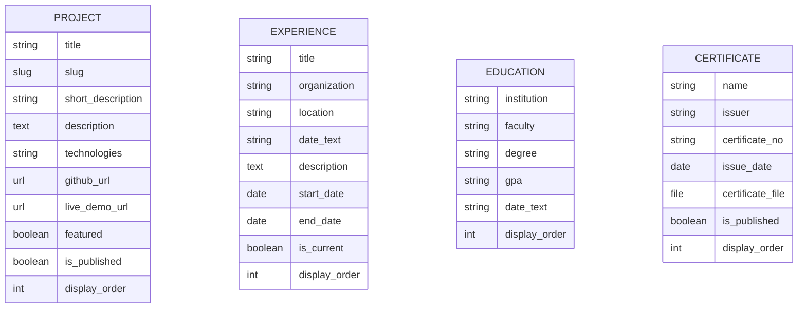

<p align="right"><a href="README.md">TR</a> | <b>EN</b></p>

<p align="center">
  
</p>

# 🌐 Umut Kılıçtaş — Django Personal Portfolio

<p>
  <a href="https://umutkilictas.tr"></a>
  
  
  
  
  
</p>

Dynamic personal portfolio web application built with **Django 5.2 LTS** and **Bootstrap 5**, featuring admin-managed content, light/dark theme support, a comprehensive unit test suite, and automated **GitHub Actions CI/CD** deployment to [umutkilictas.tr](https://umutkilictas.tr).

---

## ✨ Key Features

- **Dynamic Content Management (Django Admin):** Projects, work/internship experiences, education history, and certificates are managed and reordered directly via Django Admin (`display_order`, `is_published`, `featured`).
- **Light & Dark Theme:** Instant theme switching persisted in `localStorage` and synchronized with OS `prefers-color-scheme`.
- **Centralized Context Processor:** Owner metadata and social links are injected globally across templates via `portfolio.context_processors.portfolio_context`.
- **Custom Data Seeding Command:** Includes `python manage.py load_initial_data` to populate initial projects, experience, education, and certificates with a single command.
- **Automated Test Suite (`portfolio/tests.py`):** **10 unit tests** covering views, slug routing, `404` enforcement on unpublished items, featured project limits, and model helper methods.
- **CI/CD Pipeline (`.github/workflows/deploy.yml`):** Every push to `main` runs `manage.py check` and the unit test suite in GitHub Actions before running `collectstatic` and deploying to the live production server.
- **Production Hardening:** Automatically enables `HSTS`, `SECURE_SSL_REDIRECT`, `SESSION_COOKIE_SECURE`, `CSRF_COOKIE_SECURE`, and `NOSNIFF` headers when `DEBUG=False`.

---

## 🏗️ Data Models



---

## 📁 Project Structure

```text
django-portfolio/
├── .github/workflows/
│   └── deploy.yml                           # CI (Django check & test) + CD (collectstatic & FTP deploy)
├── config/
│   ├── settings.py                          # Environment-driven configuration & production security
│   ├── urls.py                              # Root URL routing & custom 404 handler
│   └── wsgi.py / asgi.py
├── portfolio/
│   ├── management/commands/
│   │   └── load_initial_data.py             # Custom management command to seed portfolio data
│   ├── migrations/
│   ├── admin.py                             # Customized ModelAdmin configurations
│   ├── context_processors.py                # Global template context variables
│   ├── models.py                            # Project, Experience, Education, Certificate models
│   ├── tests.py                             # 10 unit tests covering views & models
│   ├── urls.py                              # App URL patterns
│   └── views.py                             # Views (Home, About, Projects, Experience, Certificates, Contact)
├── static/                                  # Custom CSS, theme toggle JS, and SVG/PNG assets
├── templates/                               # Semantic HTML5 & Bootstrap 5 templates
├── .env.example
├── manage.py
├── requirements.txt
├── LICENSE
├── README.md                                # Turkish documentation (default)
└── README.en.md                             # English documentation
```

---

## ⚙️ Local Setup & Usage

```bash
# 1. Clone the repository
git clone https://github.com/umutkilictas/django-portfolio.git
cd django-portfolio

# 2. Create and activate a virtual environment
python -m venv .venv
# Windows PowerShell:
.\.venv\Scripts\Activate.ps1
# Linux / macOS:
source .venv/bin/activate

# 3. Install dependencies
pip install -r requirements.txt

# 4. Configure environment variables
cp .env.example .env

# 5. Run migrations and seed initial data
python manage.py migrate
python manage.py load_initial_data

# 6. Start the development server
python manage.py runserver
```

Open `http://127.0.0.1:8000/` in your browser.

---

## 🧪 Running Tests

```bash
python manage.py check
python manage.py test
```

---

## 📄 License

Licensed under the [MIT License](LICENSE).
