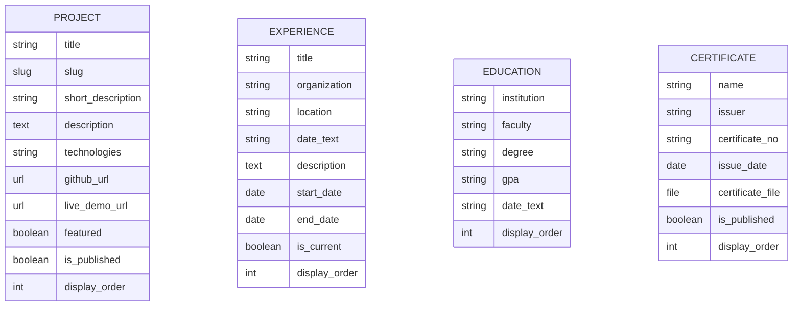

<p align="right"><b>TR</b> | <a href="README.en.md">EN</a></p>

<p align="center">
  
</p>

# 🌐 Umut Kılıçtaş — Django Kişisel Portfolyo

<p>
  <a href="https://umutkilictas.tr"></a>
  
  
  
  
  
</p>

**Django 5.2 LTS** ve **Bootstrap 5** kullanılarak geliştirilen, içeriği **Django Admin** panelinden yönetilebilen, açık/koyu tema destekli ve **GitHub Actions CI/CD** hattıyla canlı sunucuya ([umutkilictas.tr](https://umutkilictas.tr)) otomatik dağıtılan kişisel portfolyo web uygulaması.

---

## ✨ Temel Özellikler

- **Dinamik İçerik Yönetimi (Django Admin):** Projeler, iş/staj deneyimleri, akademik eğitim bilgileri ve sertifikalar kod değişikliğine gerek kalmadan admin panelinden eklenip sıralanabilir (`display_order`, `is_published`, `featured`).
- **Açık / Koyu Tema (Light & Dark Mode):** İşletim sistemi tercihiyle (`prefers-color-scheme`) ve `localStorage` ile senkronize çalışan anlık tema geçişi.
- **Merkezi Context Processor:** Site sahibi bilgileri, sosyal bağlantılar ve iletişim adresi `portfolio.context_processors.portfolio_context` üzerinden tüm şablonlara otomatik aktarılır.
- **Hazır Veri Yükleme Komutu:** `python manage.py load_initial_data` özel yönetim komutuyla projeler, eğitim, deneyim ve sertifika verileri tek komutla veritabanına yüklenebilir.
- **Birim Test Paketi (`portfolio/tests.py`):** Görünümler, `slug` yönlendirmeleri, yayınlanmamış içerik erişim kontrolü (`404`), öne çıkan proje sınırı ve model yardımcı metodlarını doğrulayan **10 otomatik birim testi**.
- **Otomatik CI/CD Dağıtımı (`.github/workflows/deploy.yml`):** `main` dalına yapılan her push işleminde önce `manage.py check` ve birim testleri çalıştırılır; testler başarılı olursa `collectstatic` alınarak canlı sunucuya otomatik dağıtılır.
- **Üretim Ortamı Güvenliği:** `DEBUG=False` modunda `HSTS`, `SECURE_SSL_REDIRECT`, `SESSION_COOKIE_SECURE`, `CSRF_COOKIE_SECURE` ve `NOSNIFF` başlıkları otomatik etkinleşir.

---

## 🏗️ Mimari ve Veri Modelleri



---

## 📁 Proje Yapısı

```text
django-portfolio/
├── .github/workflows/
│   └── deploy.yml                           # CI (Django check & test) + CD (collectstatic & FTP deploy)
├── config/
│   ├── settings.py                          # Ortam değişkenleri (.env) ve üretim güvenlik ayarları
│   ├── urls.py                              # Ana URL yönlendirmeleri ve özel 404 işleyicisi
│   └── wsgi.py / asgi.py
├── portfolio/
│   ├── management/commands/
│   │   └── load_initial_data.py             # Başlangıç verilerini yükleyen özel Django komutu
│   ├── migrations/
│   ├── admin.py                             # Özelleştirilmiş ModelAdmin tanımları
│   ├── context_processors.py                # Global şablon değişkenleri
│   ├── models.py                            # Project, Experience, Education, Certificate modelleri
│   ├── tests.py                             # 10 kapsamlı birim testi
│   ├── urls.py                              # Uygulama içi URL tanımları
│   └── views.py                             # Sayfa görünümleri (Home, About, Projects, Experience, Certificates, Contact)
├── static/                                  # Özel CSS, tema geçiş JS ve SVG ikon/görseller
├── templates/                               # Semantik HTML5 & Bootstrap 5 şablonları
├── .env.example
├── manage.py
├── requirements.txt
├── LICENSE
├── README.md                                # Türkçe dokümantasyon (varsayılan)
└── README.en.md                             # İngilizce dokümantasyon
```

---

## ⚙️ Yerel Kurulum ve Çalıştırma

```bash
# 1. Repoyu klonlayın
git clone https://github.com/umutkilictas/django-portfolio.git
cd django-portfolio

# 2. Sanal ortam oluşturun ve etkinleştirin
python -m venv .venv
# Windows PowerShell:
.\.venv\Scripts\Activate.ps1
# Linux / macOS:
source .venv/bin/activate

# 3. Bağımlılıkları yükleyin
pip install -r requirements.txt

# 4. Ortam değişkenlerini oluşturun
cp .env.example .env

# 5. Veritabanı tablolarını oluşturun ve örnek başlangıç verilerini yükleyin
python manage.py migrate
python manage.py load_initial_data

# 6. Geliştirme sunucusunu başlatın
python manage.py runserver
```

Tarayıcıda `http://127.0.0.1:8000/` adresine gidin.

---

## 🧪 Testleri Çalıştırma

```bash
python manage.py check
python manage.py test
```

---

## 📄 Lisans

Bu proje [MIT Lisansı](LICENSE) altında lisanslanmıştır.
